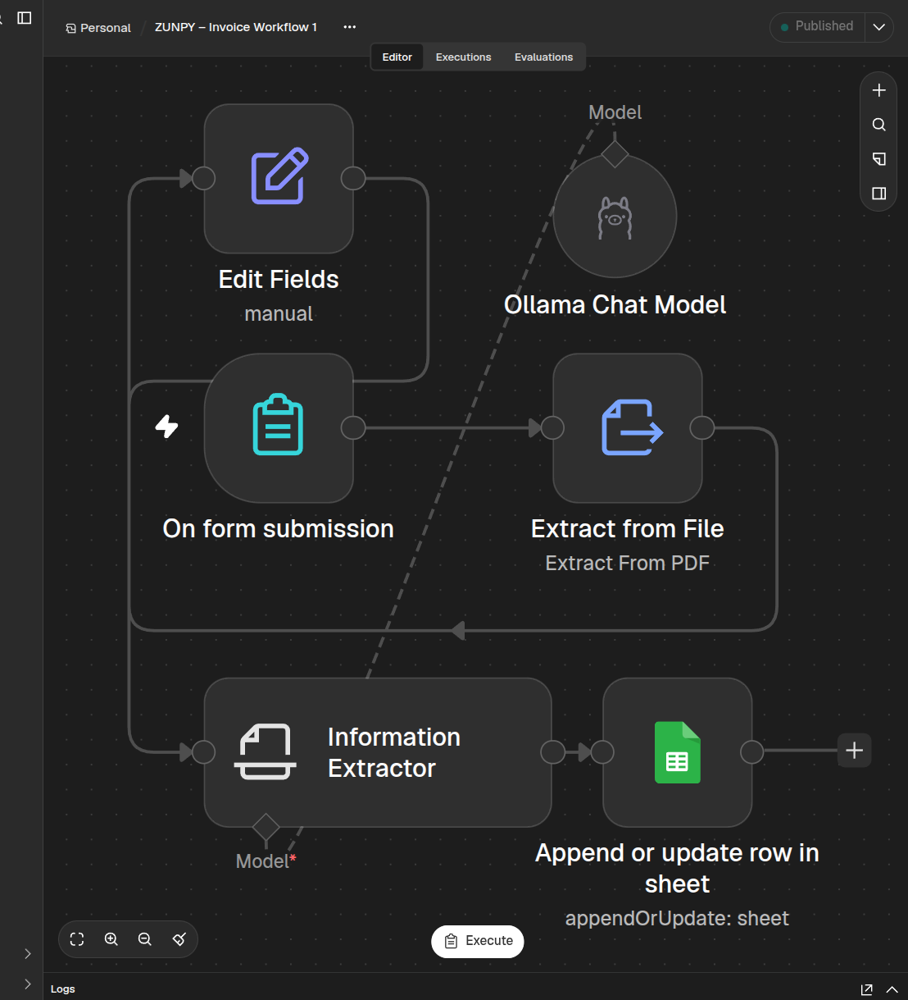
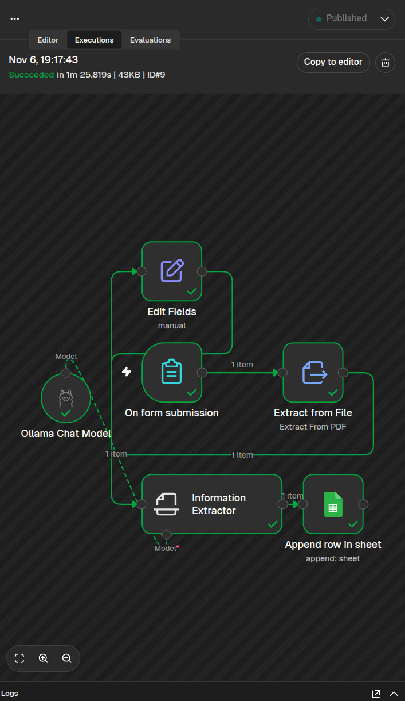
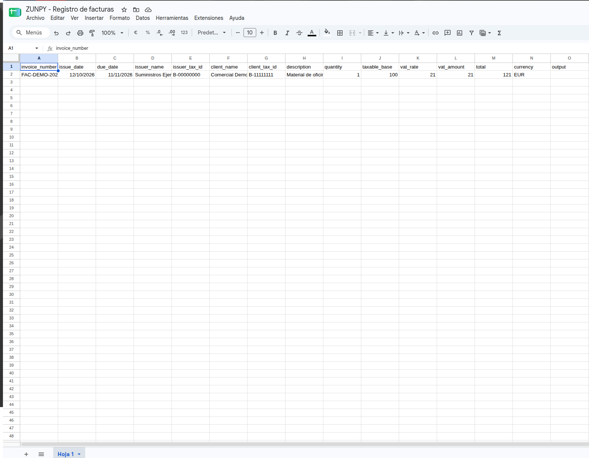

# ZUNPY – Invoice Automation

  

**Automated invoice data extraction and registration using n8n and local AI.**

## Overview

ZUNPY Invoice Automation is a workflow designed to simplify invoice processing.

It receives an invoice in PDF format, extracts relevant information using a locally hosted AI model, and records the results in Google Sheets.

The workflow also prevents duplicate invoice records by checking the invoice number before updating the spreadsheet.

This project demonstrates how workflow automation and local AI can reduce repetitive administrative tasks.

## Screenshots

### Workflow Overview

### Successful Execution

### Google Sheets Result

## Features

- PDF invoice submission through an n8n form.
- Automatic extraction of invoice information.
- AI-powered data structuring using Gemma 4.
- Google Sheets integration.
- Duplicate invoice prevention.
- Automated workflow execution.

## Extracted Information

The workflow extracts the following fields:

- Invoice number
- Issue date and due date
- Issuer and client information
- Tax identification numbers
- Invoice description
- Quantity
- Taxable amount
- VAT rate and amount
- Total amount
- Currency

## How It Works

1. **Invoice submission:** The user uploads a PDF through an n8n form.
2. **Text extraction:** n8n extracts the text from the PDF.
3. **AI processing:** Gemma 4 processes the text and structures the invoice information.
4. **Data mapping:** The extracted fields are prepared for registration.
5. **Google Sheets:** The invoice data is inserted or updated in the spreadsheet using the **Append or Update Row** operation. The `invoice_number` column acts as the matching key. If a matching invoice number is found, the existing row is updated; otherwise, a new record is added.
6. **Duplicate prevention:** The invoice number is used as the matching key to prevent duplicate records.

## Quick Start

This workflow is provided as a template and requires initial configuration to work in your environment.

1. **Import Workflow:** Import the sanitized JSON file located in `workflow/zunpy-invoice-workflow.json` into your n8n instance.
2. **Configure Credentials:**
   - Set up your own **Google Sheets** credentials within n8n.
   - Ensure your local **Ollama** instance is running and that n8n has network access to its API. Note that the connection address depends on how both services are deployed.
3. **Prepare Spreadsheet:**
   - Create or select a Google Sheet to serve as your database.
   - In the workflow, replace the `[ID_DE_TU_HOJA_DE_CALCULO]` placeholder with your actual Google Sheet ID.
   - Configure the spreadsheet tab name (e.g., `Sheet1`) to match your document.
4. **Configure Local AI:** Ensure the `gemma4:26b` model is pulled and accessible via your Ollama connection in n8n.
5. **Initial Test:** Always test the workflow with a fictional invoice before processing real business documents.
## Technology Stack

| Technology | Purpose |
|---|---|
| n8n | Workflow automation |
| Ollama | Local AI model execution |
| Gemma 4 (26B) | Invoice data extraction |
| Google Sheets | Invoice data storage |
| Docker | n8n deployment |

## Testing and Verification

The workflow was tested using a fictional invoice in PDF format.

**Verified results:**

- Successful PDF processing.
- Correct extraction of the tested invoice fields.
- Successful registration in Google Sheets.
- Successful execution when the same invoice was submitted twice.
- Only one record remained in the spreadsheet after the duplicate test.

The workflow was published as version **v1.1 – Prevent Duplicate Invoices**.

## Project Status

**Working prototype – tested with a fictional invoice.**

This project demonstrates the core workflow. It has not yet been validated against a broad range of real-world invoice formats or deployed as a production service for external clients.

## Security and Privacy

The demonstration uses fictional invoice information.

Credentials, API keys, private documents and personal information must never be included in the public repository.

## Future Improvements

Potential future developments include:

- Support for additional invoice formats.
- Improved validation of extracted information.
- Error handling and processing reports.
- Support for additional spreadsheet and accounting systems.
- Deployment options for client environments.

## About ZUNPY

ZUNPY develops practical automation solutions using Python, n8n, APIs and artificial intelligence.

Our goal is to simplify repetitive business processes through reliable, useful and maintainable automation.

---

*Built as a practical automation project by ZUNPY.*